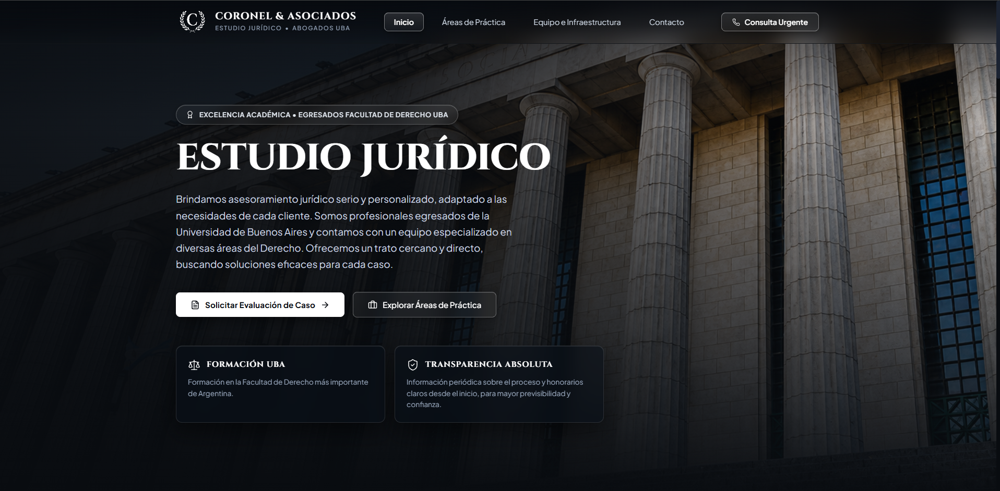
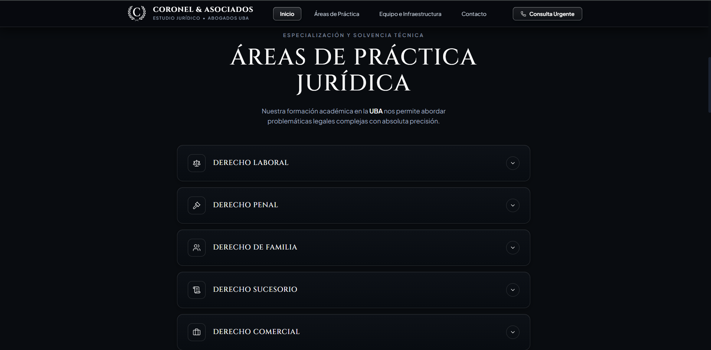
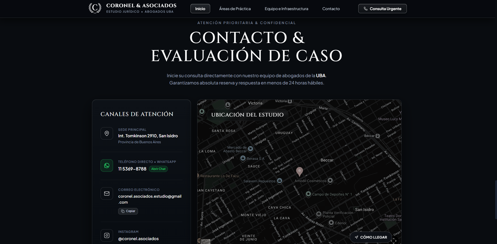

<div align="center">

  

  # ⚖️ Estudio Jurídico Coronel & Asociados
  ### *Excelencia Académica • Solvencia Técnica • Abogados UBA*

Plataforma web institucional y moderna diseñada para el **Estudio Jurídico Coronel & Asociados**, firma legal conformada por profesionales egresados de la Facultad de Derecho de la Universidad de Buenos Aires (UBA), especializada en litigios complejos, asesoramiento corporativo y resguardo patrimonial.

[](https://react.dev/)
[](https://vitejs.dev/)
[](https://oxc.rs/)
[](LICENSE)
[](https://coronelasociados.ar)

</div>

---

## 📸 Galería del Proyecto (2x2)

<div align="center">
  <table>
    <tr>
      <td width="50%" align="center">
        
        <br />
        <sub><b>🏛️ Portada Principal & Escultura 3D</b></sub>
      </td>
      <td width="50%" align="center">
        
        <br />
        <sub><b>📑 Áreas de Práctica & Especialidades</b></sub>
      </td>
    </tr>
    <tr>
      <td width="50%" align="center">
        
        <br />
        <sub><b>👥 Cuerpo de Abogados & Trayectoria UBA</b></sub>
      </td>
      <td width="50%" align="center">
        
        <br />
        <sub><b>📍 Canales de Contacto, Mapa & Consultas</b></sub>
      </td>
    </tr>
  </table>
</div>

---

## 🌟 Características Destacadas

- **Estética Editorial Prémium:** Paleta en tono *dark luxury* (`#060A10`), acentos de contraste, tipografía romana clásica (*Cinzel* y *Playfair Display*) combinada con tipografía moderna legible (*Plus Jakarta Sans*).
- **Integración 3D Interactiva:** Implementación fluida de la estatua de la justicia en formato 3D mediante `<model-viewer>` para un impacto visual diferencial.
- **Presentación Exhaustiva de Especialidades:** Catálogo interactivo de ramas jurídicas: Derecho Laboral, Penal, de Familia, Corporativo, Civil y Derecho a la Salud / Previsional.
- **Perfiles de Socios y Asociados:** Módulo dedicado al cuerpo profesional, destacando su formación académica en la Universidad de Buenos Aires (UBA) y matrículas habilitantes (CPACF, CASI, Federal).
- **Canales de Atención Directa:** Vínculo rápido a WhatsApp con mensaje precargado, copiado instantáneo de email al portapapeles y mapa interactivo con localización del despacho.
- **Arquitectura de Alto Rendimiento:** Preloader animado inicial, optimización de recursos gráficos en formatos WebP/SVG y carga ultra rápida con Vite.
- **Diseño Adaptativo (Full Responsive):** Experiencia de usuario calibrada para dispositivos móviles, tablets y monitores de alta resolución.

---

## 🛠️ Stack Tecnológico

| Componente | Tecnología | Propósito |
| :--- | :--- | :--- |
| **Framework** | [React 19](https://react.dev/) | Arquitectura de componentes declarativa y reactiva |
| **Tooling & Build** | [Vite 8](https://vitejs.dev/) | Entorno de desarrollo ultra rápido y empaquetador de producción |
| **Linter** | [Oxlint](https://oxc.rs/) | Linter de alto rendimiento en Rust para control de calidad de código |
| **Iconografía** | [Lucide React](https://lucide.dev/) | Sistema de iconos vectoriales consistentes y livianos |
| **Gráficos 3D** | [Google Model-Viewer](https://modelviewer.dev/) | Visualización y renderizado 3D web interactivo |
| **Estilos** | CSS3 Moderno | Custom properties, animaciones fluidas y técnicas de glassmorphism |

---

## 📁 Estructura del Proyecto

```text
Coronel-Asociados/
├── public/
│   ├── assets/              # Isologotipos, imágenes y recursos optimizados
│   ├── screenshots/         # Capturas de pantalla para documentación
│   ├── favicon*             # Iconos para navegadores y PWA
│   ├── robots.txt           # Configuración SEO y rastreo
│   └── sitemap.xml          # Mapa del sitio para motores de búsqueda
├── src/
│   ├── assets/              # Recursos estáticos importables
│   ├── components/
│   │   ├── AreasPractica.jsx          # Sección interactiva de especialidades
│   │   ├── Contacto.jsx               # Formulario, mapa y datos de atención
│   │   ├── EquipoInfraestructura.jsx  # Perfiles de los letrados de la firma
│   │   ├── Footer.jsx                 # Pie de página y enlaces legales
│   │   ├── HeroBanner.jsx             # Portada principal y llamados a la acción
│   │   ├── Navbar.jsx                 # Barra de navegación flotante y responsive
│   │   └── Preloader.jsx              # Pantalla de carga animada
│   ├── App.css              # Estilos específicos de la aplicación
│   ├── App.jsx              # Componente principal y navegación por anclas
│   ├── index.css            # Variables globales de diseño, temas y tipografías
│   └── main.jsx             # Punto de entrada de la aplicación
├── .oxlintrc.json           # Reglas de linting
├── index.html               # Plantilla HTML5 con metadatos SEO y Open Graph
├── package.json             # Dependencias y scripts del proyecto
└── vite.config.js           # Configuración del bundler Vite
```

---

## 🚀 Instalación y Puesta en Marcha

Sigue estos sencillos pasos para clonar y ejecutar el proyecto localmente:

### 1. Clonar el repositorio
```bash
git clone https://github.com/tu-usuario/Coronel-Asociados.git
cd Coronel-Asociados
```

### 2. Instalar dependencias
Puedes utilizar tu gestor de paquetes de preferencia (**pnpm**, **npm** o **yarn**):

```bash
# Con pnpm (recomendado)
pnpm install

# Con npm
npm install
```

### 3. Iniciar el servidor de desarrollo
```bash
pnpm dev
# o bien
npm run dev
```
La aplicación estará disponible de inmediato en `http://localhost:5173/`.

### 4. Compilar para producción
Para generar un bundle optimizado listo para desplegar:
```bash
pnpm build
# o bien
npm run build
```

Para previsualizar la compilación de producción en local:
```bash
pnpm preview
# o bien
npm run preview
```

### 5. Control de calidad de código (Linting)
```bash
pnpm lint
# o bien
npm run lint
```

---

## 👥 Equipo Legal

- **Dr. Nicolás Coronel** — Socio Fundador *(Derecho Laboral & Empresario)*
- **Dra. Micaela Zalazar** — Socia Jurídica *(Derecho Corporativo & Laboral)*
- **Dra. Patricia Massarutto** — Especialista Senior *(Derecho de la Salud & Previsional)*
- **Dr. Tomás Cutello** — Asociado Senior *(Derecho Civil & Penal)*

*Todos los profesionales son letrados egresados de la Facultad de Derecho de la Universidad de Buenos Aires (UBA).*

---

## 📄 Licencia

Este proyecto y su contenido institucional son propiedad privada de **Estudio Jurídico Coronel & Asociados**. Todos los derechos reservados.
